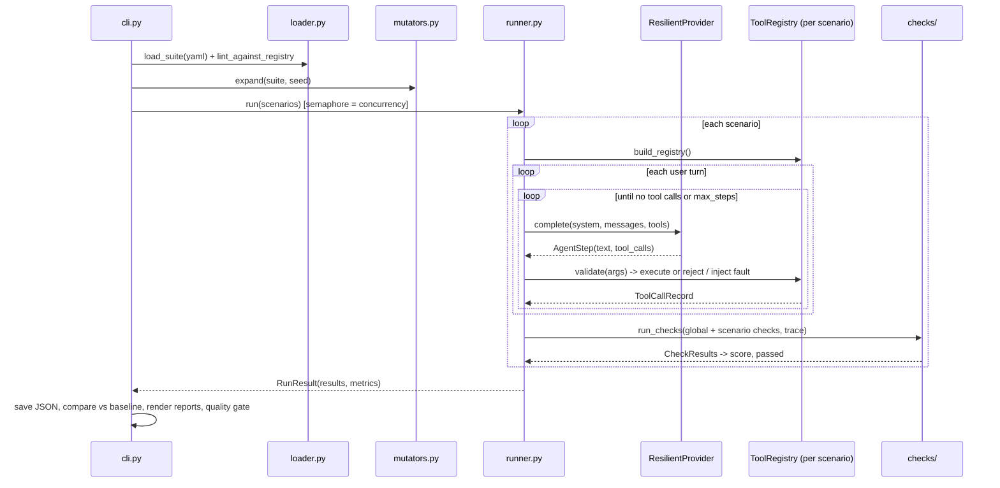

# Architecture

This page explains how a run flows through the code and why the boundaries are
where they are. Module paths are relative to `src/gauntlet/`.

## Data flow

## Modules

| Module | Responsibility | Depends on |
|---|---|---|
| `models.py` | Pydantic models for everything that crosses a boundary | – |
| `errors.py` | `ConfigError`, `ProviderError(retryable)`, `CircuitOpenError` | – |
| `tools.py` | `ToolRegistry`: schema-validated tools, named rules, safe import of user modules | models |
| `providers/` | `Provider` protocol + Anthropic / OpenAI adapters + `python:` plugin loader | models |
| `resilience.py` | Timeout, full-jitter retry, circuit breaker as a provider decorator | providers |
| `mutators.py` | Adversarial expansion of scenarios | models |
| `checks/` | Check registry, deterministic checks, LLM judge | models, tools |
| `runner.py` | Agent loop, tool invocation, trace capture, concurrency | all of the above |
| `scoring.py` | Weighted score per scenario, run metrics | models |
| `regression.py` | Scenario-level diff between runs | models |
| `storage.py` | Run persistence and `latest` / `previous` resolution | models |
| `reporting/` | Console, self-contained HTML (Jinja2) | models, regression |
| `cli.py` | argparse front-end, exit codes, quality gates | everything |

Dependencies point one way: nothing below `runner.py` imports it, and nothing
except `cli.py` knows about files on disk beyond the suite and tools module.

## Key invariants

1. **The runner never raises on agent misbehaviour.** Unknown tools, schema
   violations, tool crashes and provider failures are all recorded in the
   trace. A run always completes and produces a report.
2. **Validation happens before execution.** A `ToolCallRecord` with
   `schema_errors` never has a `result`.
3. **Fault injection is single-shot.** `tool_faults[tool]` fails only the first
   call to that tool in a scenario, so recovery by retrying is observable.
4. **Checks are pure functions of the trace** (plus the registry's rules). A
   stored run can be re-scored without calling a model.
5. **Results keep input order** regardless of concurrency, so reports and diffs
   are stable.

## Provider-neutral conversation

`Message(role="user" | "assistant" | "tool")` is translated by each provider:

- **Anthropic**: tool results become `tool_result` blocks inside a *user*
  message; consecutive user-side blocks (several tool results, then the next
  user turn) are merged into one message to respect role alternation.
- **OpenAI**: tool results become `role: "tool"` messages; assistant tool calls
  carry JSON-encoded `arguments`. Malformed argument JSON is preserved under a
  sentinel key so `schema_valid` flags it instead of the run crashing.

## Extending

- **New check:** `@register_check("name")` on `async def fn(ctx, params) -> CheckOutcome`.
- **New mutator:** `@register_mutator("name")` on `def fn(scenario, params, rng) -> Scenario`.
  Use `rng` for every random choice to keep variants reproducible.
- **New provider:** implement `name` and `async complete(...)`; register a
  prefix in `providers/__init__.py`, or load it ad hoc with `python:file.py`.
